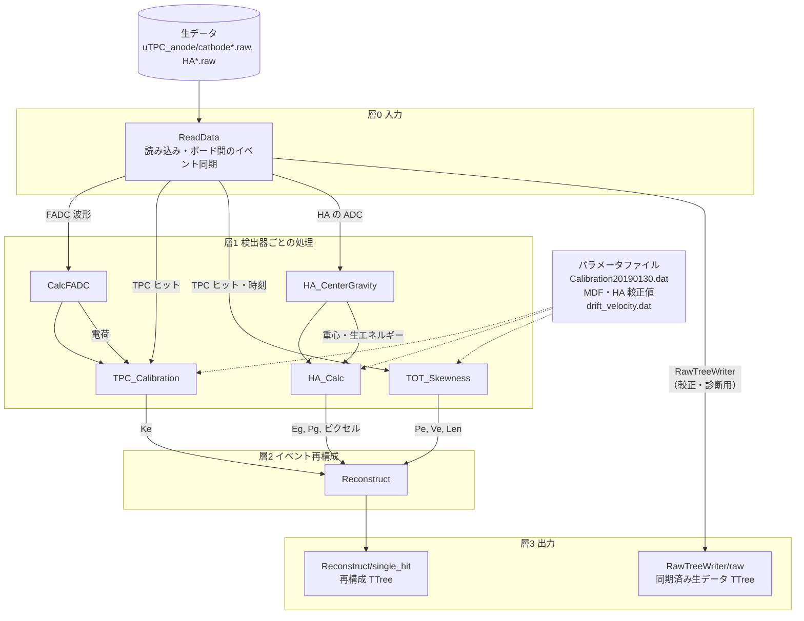
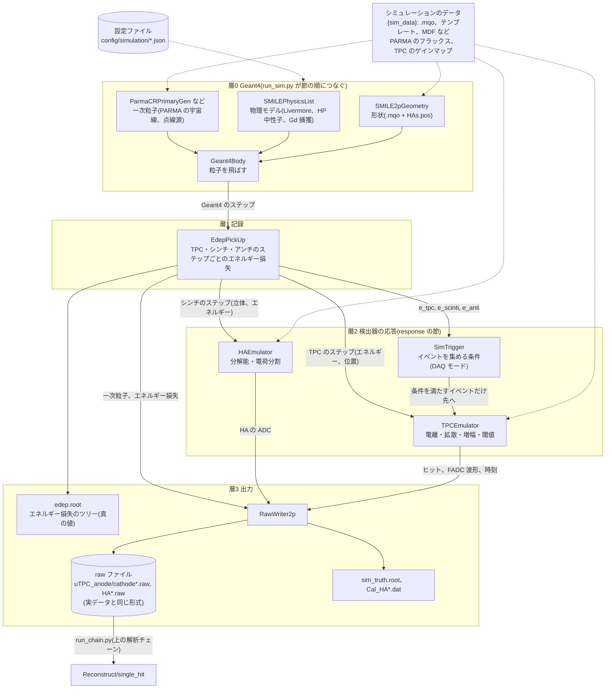

# EricaNext_try

**SMILE-2+ データで EricaNext の再構成チェーンを動かすための作業リポジトリ**

[EricaNext](https://github.com/SMILE-tool-box/EricaNext) は、SMILE プロジェクトの検出器生データ
（detector raw data）から、天体解析が可能なイベント再構成（event reconstruction）までを
一貫して処理するパイプラインソフトウェアです。ANLnext フレームワークをベースに構築されており、
解析モジュールを組み合わせてデータ処理フローを構成します。

`EricaNext_try` は、その中でもまず **SMILE-2+ の生データで再構成し**、ETCC解析についてのチュートリアル的な役割です。

## 使い方(まずここ)

実行するスクリプトは 2 つです。どちらも **最初の引数に設定ファイル** を渡します。
設定ファイルに、つなぐモジュールとそのパラメータ、データの場所をすべて書いておき、スクリプトはそれを読んでチェーンを組んで実行します。

| スクリプト | すること | 設定ファイル |
| --- | --- | --- |
| [`run_script/run_chain.py`](run_script/run_chain.py) | 生データ(実データ・シミュレーションの raw)の **再構成** | [`config/<名前>.json`](config/) |
| [`run_script/run_sim.py`](run_script/run_sim.py) | Geant4 の **シミュレーション**(検出器の応答をつけると実データと同じ形式の raw も書く) | [`config/simulation/<名前>.json`](config/README.md) |

```bash
cd run_script

# 再構成: 設定ファイル smile2p_20190701_Per02(= config/smile2p_20190701_Per02.json)
python3 run_chain.py smile2p_20190701_Per02 -o per02_out.root               # 全イベント
python3 run_chain.py smile2p_20190701_Per02 -o test.root -n 10000           # 先頭 1 万イベント
python3 run_chain.py smile2p_20190701_Per02 -o raw.root --raw --compression 505   # 同期した生データのツリー

# シミュレーション
python3 run_sim.py smile2p_flight_parma_thermal_neutron_d10 -n 1000000 -o edep.root --seed 1
python3 run_sim.py smile2p_flight_parma_thermal_neutron_d10_raw -n 1000000 -o edep.root --seed 1 --raw-dir rawdata

# シミュレーションの raw を再構成する(上の rawdata を読む)
python3 run_chain.py smile2p_sim_d10_recon -o sim_recon.root --set ReadData.data_dir=rawdata
```

- 設定ファイルは名前(拡張子なし)で書くと `config/`(`run_sim.py` は `config/simulation/`)から探します。`.json` のパスを直接書いても構いません。
  省くとエラーになり、使える名前の一覧が出ます。
- 値を変えるときは、設定ファイルをコピーして書き換えるか、`--set` でその場だけ上書きします
  (`run_chain.py` は `--set モジュール.パラメータ=値`、`run_sim.py` は `--set 節.キー=値`)。
- 設定ファイルの各モジュールには、全パラメータの説明(`_doc`)と単位(`_units`)を書いています。
- 失敗すると終了コード 1 で終わります(データを最後まで読んだときと `-n` で止めたときは 0)。

| `run_chain.py` の引数 | 意味 |
| --- | --- |
| `<設定>` | 設定ファイル(必須) |
| `-o` | 出力の ROOT ファイル(必須) |
| `-n` | 処理するイベント数。省略すると全イベント |
| `--raw` | 再構成せず、`ReadData → RawTreeWriter` で同期した生データのツリーだけを書く |
| `--compression` | ROOT の圧縮設定(`505` = zstd レベル 5) |
| `--set モジュール.パラメータ=値` | パラメータの上書き(何回でも)。小数は `10.0` のように書く |

| `run_sim.py` の引数 | 意味 |
| --- | --- |
| `<設定>` | 設定ファイル(必須) |
| `-n` | 一次粒子の数(必須) |
| `-o` | エネルギー損失のツリー(`edep`)を書く ROOT ファイル。省略すると設定ファイルの値 |
| `--seed` | 乱数の種。省略すると設定ファイルの値 |
| `--raw-dir` | raw ファイルの出力先(`response` の節がある設定だけ) |
| `--set 節.キー=値` | パラメータの上書き(何回でも)。例: `physics.em_msc=urban`、`response.TPCEmulator.Vth_Anode=6000` |

詳しい説明(出力の中身、例、中でしていること)は [`run_script/README.md`](run_script/README.md)、
設定ファイルの書き方は下の「[設定ファイルで実行する](#設定ファイルで実行する)」と [`config/README.md`](config/README.md) にあります。

## 解析チェーン



- 矢印はデータの受け渡しです(ラベルは渡すもの)。点線はパラメータファイルの読み込みです。
- 実際の実行順は `ReadData → CalcFADC → TPC_Calibration → HA_CenterGravity → HA_Calc → TOT_Skewness → Reconstruct`
  (SMILE_tool_box の `setting.mac` と同じ)。`RawTreeWriter` は使うときだけ `ReadData` の直後につなぎます。
- 出力ファイルには TTree だけを書きます(図は保存しません)。処理の中身を確かめる図は、
  `RawTreeWriter/raw` と `Reconstruct/single_hit` から後で描きます(`tutorials_caldata/1_DataIO/modules/`)。
- どのモジュールも、失敗してもチェーンを止めずにセンチネル値(`0xffffffff`)を入れて続行します。
  解析では `single_hit` の `err_flag == 0` の行だけを使ってください。
- 実行時間の大半は生データの読み込みです。データはネットワーク越しではなく手元のディスクに置くと約 10 倍速くなります。

| モジュール | SMILE_tool_box での名前 | 主な出力 |
| --- | --- | --- |
| `ReadData` | `RawRead2p` | 同期したイベントの TPC ヒット・FADC 波形・HA の ADC |
| `CalcFADC` | `CalcFADC` | FADC 24 ch の電荷 |
| `TPC_Calibration` | `TPC_Calibration` | 反跳電子のエネルギー `Ke` |
| `HA_CenterGravity` | `HA_Center_Gravity` | PMT ごとの重心と生エネルギー |
| `HA_Calc` | `HA_Calc_s2` | 散乱ガンマ線のエネルギー `Eg`、吸収点 `Pg`、ピクセル |
| `TOT_Skewness` | `TOT_Skewness_Analysis` | 散乱点 `Pe`、電子の方向 `Ve`、飛程 `Len` |
| `Reconstruct` | `Reconstruct` | 再構成ツリー `Reconstruct/single_hit` |
| `RawTreeWriter` | (なし) | 生データツリー `RawTreeWriter/raw` |

## シミュレーションチェーン



- 矢印はデータの受け渡し(ラベルは渡すもの)、点線は設定ファイルとデータファイルの読み込みです。
- 実際の実行順は `SMILE2pGeometry → SMILEPhysicsList → ParmaCRPrimaryGen → Geant4Body → StandardUserActionAssembly → EdepPickUp → SimTrigger → TPCEmulator → HAEmulator → RawWriter2p`
  (SMILE_tool_box の haboc のマクロ `[Def] SMILE_2p, TPC_emulator, Emu_HA, EmuWrite2p` と同じ流れ)。`response` の節が無い設定では `EdepPickUp` で終わります。
- `SimTrigger` は条件を満たさないイベントで `AS_SKIP` を返し、そのイベントでは後ろのモジュール(応答と raw の書き出し)を動かしません。
- raw ファイルは実データと同じ形式なので、上の解析チェーンでそのまま再構成できます(設定 `config/smile2p_sim_d10_recon.json`)。

| モジュール | SMILE_tool_box での名前 | 主な出力 |
| --- | --- | --- |
| `SMILE2pGeometry` | `SMILE_2p_Geo` | SMILE-2+ の形状(flight / ground / no_vessel) |
| `SMILEPhysicsList` | `SMILE_PhysicsList` | 物理モデル(e± の多重散乱 gs / urban、Gd の捕獲) |
| `ParmaCRPrimaryGen` | `SMILE_2p_PA_CR` | PARMA のフラックスに従う宇宙線の一次粒子 |
| `EdepPickUp` | `SMILE_2p_Step` | エネルギー損失のツリー `edep` |
| `SimTrigger` | `DAQ_Mode` | イベントを集めるかどうか |
| `TPCEmulator` | `TPC_emulator` | ボードごとのヒットと FADC 波形 |
| `HAEmulator` | `Emu_HA` | HA の ADC、`Cal_HA*.dat` |
| `RawWriter2p` | `EmuWrite2p` | raw ファイル、真の値 `sim_truth.root` |
| `StepLimit` | (なし) | ステップの長さの上限(今の設定ファイルでは使っていない) |
| `GeometryImage` | (なし) | 形状を画面無しで PNG に描く(`run_script/draw_geometry.py` が使う) |

## 検証状況

各モジュールは SMILE_tool_box_v2.20 と同じ処理になるよう移植し、20190701_Per02 のデータで
参照出力（`haboc_tmp_0.root` の `Reconstruct/s2t`）とビット単位で一致することを確認しています。
経緯は [`docs/per02_comparison_log.md`](docs/per02_comparison_log.md) を参照してください。

## チュートリアル

[`tutorials_caldata/`](tutorials_caldata/README.md) に、cosipy と同じ形式のチュートリアルがあります。
番号の順に読みます。データの入手方法は 1_DataIO にまとめてあります。

| フォルダ | 内容 |
| --- | --- |
| [`tutorials_caldata/0_Introduction/`](tutorials_caldata/0_Introduction/Introduction.ipynb) | SMILE-2+ の構成と座標系の定義(最初に読む) |
| [`tutorials_caldata/1_DataIO/`](tutorials_caldata/1_DataIO/DataIO_example.ipynb) | データのダウンロードと Erica によるデータ再構成。`modules/` 以下に各モジュールの解説(チェーンの順に番号付き) |
| [`tutorials_caldata/2_EventSelection/`](tutorials_caldata/2_EventSelection/EventSelection.ipynb) | イベント選択と、カットごとのエネルギースペクトルの変化 |
| [`tutorials_caldata/3_Backprojection/`](tutorials_caldata/3_Backprojection/Backprojection.ipynb) | 較正データのバックプロジェクション像 |

シミュレーションのチュートリアルは [`tutorials_simulation/`](tutorials_simulation/README.md) にあります。

| フォルダ | 内容 |
| --- | --- |
| `tutorials_simulation/0_Introduction/` | シミュレーションの全体の流れ、形状、環境(移植中) |
| [`tutorials_simulation/1_DataIO/`](tutorials_simulation/1_DataIO/DataIO_example.ipynb) | シミュレーションの実行と出力の読み方、シミュレーションの raw の再構成 |
| `tutorials_simulation/2_PointSourceSim/` | 点線源のシミュレーション(準備中) |
| `tutorials_simulation/3_ParallelBeamSim/` | 平行光シミュレーション(準備中) |
| `tutorials_simulation/4_CosmicBGSim/` | 宇宙線バックグラウンドシミュレーション(準備中) |
| [`tutorials_simulation/5_PARMAFlux/`](tutorials_simulation/5_PARMAFlux/README.md) | PARMA で宇宙線のフラックスを作る(準備中) |

> **注意（Jupyter 実行時）**: `CalcFADC` は波形積分を `std::thread` で行うため、Jupyter の
> ipykernel プロセス内でチェーンをそのまま実行すると、カーネルごと落ちることがあります
> （プレーンな python スクリプトとしての実行では問題ありません）。そのためチュートリアルでは
> チェーンを別プロセスのスクリプトとして書き出し、`subprocess` で実行しています（`run_script/run_chain.py` を `subprocess` で呼ぶ）。

---

## 依存関係

| ソフト | 版 | 入れ方 |
| --- | --- | --- |
| [ROOT](https://root.cern/) | 6.36 で確認 | 各自(この環境では `/usr/local/root`、`thisroot.sh` を `~/.bashrc` で読む) |
| [Boost](https://www.boost.org/) | 1.80.0 以降 | 各自 |
| CMake | 3.20 以降 | システム |
| C++ コンパイラ | C++17 | システム |
| [SWIG](https://www.swig.org/) | | システム(Python 拡張の生成に必須) |
| Python 3 | 3.9 で確認 | システム(`/usr/bin/python3`) |
| Ruby の開発用ヘッダ、readline | | システム(ANLNext が Ruby の拡張をいつも作るため) |
| xerces-c、expat | | システム(Geant4 の GDML 用。例 `sudo dnf install xerces-c-devel expat-devel`) |
| [Geant4](https://geant4.web.cern.ch/) | 11.4.3 | 下の `install_all.sh` が `~/opt` に入れる |
| [ANLNext](https://github.com/odakahirokazu/ANLNext) | c22eb3e | 同上(ベクトル型のパラメータ有効) |
| [ComptonSoft](https://github.com/odakahirokazu/ComptonSoft) | bbe3486 | 同上。**中に入っている anlgeant4 を使うために入れる**(ComptonSoft 本体は使わない。シミュレーションだけで使う) |

ComptonSoft は、ANLNext のモジュールとして Geant4 を動かす部品 **anlgeant4**(`Geant4Body`、`VANLGeometry`、`VANLPhysicsList`、`BasicPrimaryGen`、
`PointSourcePrimaryGen`、`StandardUserActionAssembly` など)を使うために入れます。anlgeant4 は ComptonSoft のリポジトリの中(`anlgeant4/`)にしか無く、
ComptonSoft の CMake には anlgeant4 だけを作るオプションが無いので、ComptonSoft ごとビルドします。実データの解析には要りません。

ANLNext は 1 つ(`~/opt/anlnext-g4`)で、実データの解析(`source/`)とシミュレーション(`simulation_source/`)の両方で使います。
シミュレーションの anlgeant4 がベクトル型のパラメータ(`ANLNEXT_USE_G4VECTOR=ON`)を必要とするのでそのようにビルドしています。
実データの解析もこの ANLNext で、普通にビルドした ANLNext のときとビット単位で同じ結果になります。

---

## インストール

### 1. Geant4、ANLNext、ComptonSoft、EricaNext を入れる

スクリプト 1 本で、すべて `~/opt` に入れて EricaNext_try をビルドします。`~/opt` の外(`/usr/local`、`~/.bashrc` など)は変えません。

```bash
bash scripts/env/install_all.sh
```

| 順 | スクリプト | すること |
| --- | --- | --- |
| 1 | `scripts/env/build_geant4.sh` | Geant4 11.4.3 を `~/opt/geant4-11.4.3` に(GDML、マルチスレッド、`GEANT4_BUILD_TLS_MODEL=global-dynamic`)。物理データ(約 2 GB)は初回だけ `~/opt/geant4-data-11.4.3` にダウンロード |
| 2 | `scripts/env/make_g4ndl_ar36fix.sh` | 中性子のデータ G4NDL4.7.1 に G4NDL4.5 の Ar-36/38 を補ったもの(`~/opt/geant4-data-extra/G4NDL4.7.1_Ar36fix`) |
| 3 | `scripts/env/build_anlnext_comptonsoft.sh` | ANLNext を `~/opt/anlnext-g4` に、ComptonSoft(anlgeant4 を使うため)を `~/opt/comptonsoft` に(ソースが無ければ GitHub から取ってくる) |
| 4 | (コピー) | 環境を設定する `scripts/env/setup_ericanext.sh` を `~/opt/setup_ericanext.sh` に置く |
| 5 | `scripts/env/build_ericanext.sh` | EricaNext_try をビルド: 実データの解析 `source/ → install/`、シミュレーション `simulation_source/ → simulation_source/install/` |
| 6 | `scripts/env/make_jupyter_kernel.sh` | Jupyter のカーネル「EricaNext」を登録(環境変数をカーネルに書いておく。ROOT の環境もそのとき写すので、`thisroot.sh` を読んだシェルで実行する) |

コードを直したあとに EricaNext_try だけをビルドし直すときは、5 だけを実行します(`bash scripts/env/build_ericanext.sh`)。

**Geant4 がすでに入っている場合**は、それを使えます(Geant4 をもう一つ入れない)。`GEANT4_INSTALL` にその場所(`bin/geant4.sh` がある所)を渡します。

```bash
GEANT4_INSTALL=/path/to/geant4 bash scripts/env/check_geant4.sh    # 使えるか確かめるだけ
GEANT4_INSTALL=/path/to/geant4 bash scripts/env/install_all.sh
```

`check_geant4.sh` が、GDML が有効か、マルチスレッドのときに TLS のモデルが `global-dynamic` か(でないと Python から Geant4 を読み込めない)、
物理データがそろっているか、版(確かめたのは 11.4.3)を調べ、使えなければ理由を表示して止まります。その Geant4 自体は変えません。

### 2. 環境を設定する

EricaNext は、`~/opt` の Geant4、ANLNext、ComptonSoft を使います。その場所は `~/opt/setup_ericanext.sh` が環境変数
(`PATH`, `LD_LIBRARY_PATH`, `PYTHONPATH`, `ANLNEXT_INSTALL` など)で設定します。
ANLNext は `import anlnext` だけでも Geant4 のライブラリ(`libG4clhep.so`)を使うので、実データの解析にもこの環境が要ります。

| 使い方 | すること |
| --- | --- |
| ターミナル | 使うときに `source ~/opt/setup_ericanext.sh` してから `run_chain.py` / `run_sim.py` を実行する |
| Jupyter | カーネル「**EricaNext**」を選ぶ(環境変数がカーネルに書いてあるので、何も読み込まなくてよい) |

> **ほかの Geant4 や ANLNext を使っている人は、`setup_ericanext.sh` を `~/.bashrc` に書かないでください。**
> `PATH`、`LD_LIBRARY_PATH`、`PYTHONPATH`、`ANLNEXT_INSTALL` がこの Geant4・ANLNext を指すようになり、
> 自分のコードのビルドや実行、Geant4 の物理データの場所が変わってしまいます。EricaNext を使うときだけ読み込むか、Jupyter のカーネルを使ってください。
> ほかに使っていなければ、`~/.bashrc` に `source ~/opt/setup_ericanext.sh` を書いても構いません(ROOT の `thisroot.sh` の後)。

中性子のデータ(`G4NEUTRONHPDATA`、Ar-36/38 を補った G4NDL)は、環境ではなくシミュレーションの設定ファイルの `environment` の節で指定します
(`run_sim.py` がその実行の中だけで設定する)。

確認:

```bash
source ~/opt/setup_ericanext.sh
python3 -c "import anlnext, anlgeant4; print(anlnext.__file__)"     # ~/opt/anlnext-g4/lib/python/anlnext/__init__.py
jupyter kernelspec list                                             # ericanext があること
```

### ANLNext のビルドのオプション

`build_anlnext_comptonsoft.sh` が使っている指定です。

| 指定 | 意味 |
| --- | --- |
| `-DCMAKE_INSTALL_PREFIX=~/opt/anlnext-g4` | インストール先(既定は `$HOME`) |
| `-DANLNEXT_USE_G4VECTOR=ON` | パラメータに Geant4 の CLHEP のベクトル型を使う(anlgeant4 に必須。既定 OFF) |
| `-DGeant4_DIR=~/opt/geant4-11.4.3/lib64/cmake/Geant4` と環境変数 `LIBRARY_PATH` に Geant4 の `lib64` | `G4clhep` にリンクするため(ANLNext はリンク先のディレクトリを指定しない) |
| `-DRUBY_CONFIG_FILE_DIR=/usr/include` | Ruby の設定のヘッダの場所(見つからないと cmake が止まる環境がある) |
| `-DPython3_EXECUTABLE=/usr/bin/python3` | Python 拡張を作る Python(実行する Python と同じにする) |
| `-DCMAKE_INSTALL_RPATH=...` | 実行時に ANLNext と Geant4 のライブラリを見つけるため |

ほかのオプション(`ANLNEXT_USE_READLINE`, `ANLNEXT_ENABLE_INTERACTIVE_MODE`, `ANLNEXT_INSTALL_HEADERS`, `ANLNEXT_INSTALL_CMAKE_FILES`、どれも既定 ON)は既定のままです。
`ANLNEXT_INSTALL_HEADERS` と `ANLNEXT_INSTALL_CMAKE_FILES` は EricaNext のビルド(ヘッダ、SWIG の cmake のモジュール)に必要なので OFF にしないでください。

### EricaNext のビルドの指定

`build_ericanext.sh` が使っている指定です。手で実行するときも同じです。

```bash
mkdir build install && cd build
cmake ../source -DCMAKE_INSTALL_PREFIX=../install -DANLNEXT_INSTALL=$ANLNEXT_INSTALL -DPython3_EXECUTABLE=/usr/bin/python3
make -j8 && make install
```

| オプション | 説明 |
| --- | --- |
| `-DCMAKE_INSTALL_PREFIX=../install` | インストール先。`run_script/*.py` はリポジトリの `install/lib/python` を読むので、この場所のままにする |
| `-DANLNEXT_INSTALL=...` | ANLNext の場所(未指定なら環境変数 `ANLNEXT_INSTALL`、それも無ければ `$HOME`) |
| `-DPython3_EXECUTABLE=...` | Python が何種類も入っている環境(conda / pyenv / system など)で、使う Python を固定する(`CreateSwigPython.cmake` は `find_package(Python3 ...)` を使う) |
| `make -j8` | ビルドの並列数。使うコア数に合わせて変える |

---

## 使い方

チュートリアルは [`tutorials_caldata/`](tutorials_caldata/README.md) を参照してください。

### 設定ファイルで実行する

モジュールの順番とパラメータ、データ・較正ファイルの場所は、測定期間ごとの設定ファイル
[`config/*.json`](config/) にまとめています(SMILE_tool_box の参照実行と同じ値)。値を変えるときは設定ファイルだけを直します。
実行のしかたは上の「[使い方(まずここ)](#使い方まずここ)」、設定ファイルの書き方は [`config/README.md`](config/README.md) にあります。

#### データの置き場所(自分の環境に合わせて変える場所)

データはリポジトリに入っていません。研究室の NAS の、EricaNext_try のデータの置き場にまとめてあります。

> **NAS(`/mnt/nas_eureka`)へのつなぎ方**: 宇宙線研究室の hikaru サーバー、または akari サーバーに VPN でつないで使います
> (NAS はこれらのサーバーにマウントされています)。VPN のつなぎ方は SMILE の wiki のマニュアル
> [Erica_manual.pdf](http://192.168.1.172/smile_wiki/gitlab?action=AttachFile&do=view&target=Erica_manual.pdf)(研究室のネットワークの中から見られる)を参照してください。

```
/mnt/nas_eureka/onoda/EricaNext_try_data/SMILE2+/     ← config/ericanext_config.py の DATA_DIR(環境変数 SMILE2P_DATA で変えられる)
├── calibration_data/                                 ← 設定ファイルの {data_top}
│   ├── sm2+_cal_rawdata/20190701_Per02/              ← 生データ(uTPC_*.raw, HA*.raw)と drift_velocity.dat
│   ├── sm2+_cal_rawdata/20190701_Per03/
│   └── param/20190528/                               ← 較正ファイル(Calibration20190130.dat, XMDF/YMDF, Cal_HA, HAs.pos など)
├── TPC_caldata/                                      ← {tpc_caldata}: TPC だけの較正データ(20171219/Per01_TPC など、ゲインマップ用)
└── simulation_data/
    ├── parameters/smile2p_sim_data/                  ← {sim_data}: シミュレーションのデータ(SMILE_tool_box_v2.20/data と emulator_param)
    └── parma_flux/                                   ← {parma_flux}: PARMA の宇宙線のフラックス(parma_flux_d<深さ>_g10_thermal.root)
```

- **NAS を読める計算機では、設定ファイルを書き換えずにそのまま動きます。**
- 手元のディスクにコピーして使う(読み込みが速くなる)ときや、別の場所に置いたときは、**同じ並び**で置いて、環境変数 `SMILE2P_DATA` にその一番上を設定します。
  `{data_top}`, `{tpc_caldata}`, `{sim_data}`, `{parma_flux}` はすべて `SMILE2P_DATA` の下になります。

  ```bash
  export SMILE2P_DATA=~/EricaNext_try_data      # 中に calibration_data/, TPC_caldata/, simulation_data/
  ```

並びが違う場所に置いた場合だけ、設定ファイル(例: `config/smile2p_20190701_Per02.json`)の次の値を自分のパスに書き換えます。
`{data_top}` を使わずに絶対パスを書いても構いません。

| モジュール | キー | 中身 | 既定値 |
| --- | --- | --- | --- |
| `ReadData` | `data_dir` | 生データのディレクトリ | `{data_top}/sm2+_cal_rawdata/20190701_Per02` |
| `TPC_Calibration` | `ParameterFile` | TPC の較正ファイル | `{data_top}/param/20190528/Calibration20190130.dat` |
| `HA_Calc` | `parameter_dir` | HA の MDF・較正値・`HAs.pos` のディレクトリ | `{data_top}/param/20190528` |
| `HA_Calc` | `Modified_Parameter_Data_Dir` | PMT ゲイン補正(`Mean_Sigma_HA*`)のディレクトリ | `{data_top}/param/20190528` |
| `TOT_Skewness` | `drift_velocity_file` | ドリフト速度の表 | `{data_top}/sm2+_cal_rawdata/20190701_Per02/drift_velocity.dat` |

- `reference` の 2 つのパス(`setting_mac`, `root`)は、SMILE_tool_box の出力との比較に使うだけで、チェーンの実行には使いません(研究室サーバーの `hikaru3_analysis2` を指しています)。
- どのパスが使われるかは、次で確認できます。
  ```bash
  python3 -c "import sys; sys.path.insert(0, 'config'); import ericanext_config as ec, json; \
              print(ec.data_root()); print(json.dumps(ec.load('smile2p_20190701_Per02')['parameters'], indent=1))"
  ```

### Python から直接使う

ビルドした Python モジュールは `<CMAKE_INSTALL_PREFIX>/lib/python` にインストールされます。
Python から import するには、このディレクトリを `PYTHONPATH` に追加してください。

```bash
export PYTHONPATH=<CMAKE_INSTALL_PREFIX>/lib/python:$PYTHONPATH
```

> **注意**: `/usr/local/lib/python` など、他の場所に別ビルドの `EricaPy` が入っていることが
> あります。`PYTHONPATH` は必ず `EricaNext_try/install/lib/python` を先頭（優先）に
> なるよう追加してください。順序を間違えると意図しない方のビルドが import され、
> パラメータやモジュールの挙動が変わって気づきにくいバグになります。

```python
import anlnext
import EricaPy as erica

a = anlnext.AnalysisChain()
a.chain(erica.SaveFile)
a.with_parameters({"filename": "output.root"})
a.chain(erica.ReadData)
a.with_parameters({"data_dir": "/path/to/raw/data", "reverse_TPC": False, "TPC_Only": False})
# ... CalcFADC, TPC_Calibration, TOT_Skewness, HA_CenterGravity, HA_Calc, Reconstruct と続く
a.run(-1)
```
