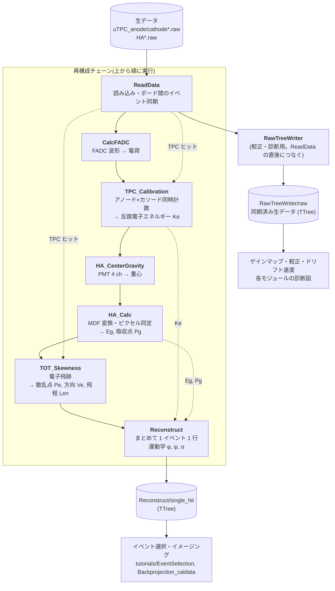

# EricaNext_try

**SMILE-2+ データで EricaNext の再構成チェーンを動かすための作業リポジトリ**

[EricaNext](https://github.com/SMILE-tool-box/EricaNext) は、SMILE プロジェクトの検出器生データ
（detector raw data）から、天体解析が可能なイベント再構成（event reconstruction）までを
一貫して処理するパイプラインソフトウェアです。ANLnext フレームワークをベースに構築されており、
解析モジュールを組み合わせてデータ処理フローを構成します。

`EricaNext_try` は、その中でもまず **SMILE-2+ の生データで再構成が通る状態**を作ることを
目的に、モジュールを 1 つずつ移植・検証しているディレクトリです。

## 解析チェーン



- 実線はチェーンの実行順、点線は主なデータの受け渡しです。
- 出力ファイルには TTree だけを書きます(図は保存しません)。処理の中身を確かめる図は、
  `RawTreeWriter/raw` と `Reconstruct/single_hit` から後で描きます(`tutorials/DataIO/modules/`)。
- どのモジュールも、失敗してもチェーンを止めずにセンチネル値(`0xffffffff`)を入れて続行します。
  解析では `single_hit` の `err_flag == 0` の行だけを使ってください。
- 実行時間の大半は生データの読み込みです。データはネットワーク越しではなく手元のディスクに置くと約 10 倍速くなります。

| モジュール | SMILE_tool_box での名前 | 主な出力 |
| --- | --- | --- |
| `ReadData` | `RawRead2p` | 同期したイベントの TPC ヒット・FADC 波形・HA の ADC |
| `CalcFADC` | `CalcFADC` | FADC 24 ch の電荷 |
| `TPC_Calibration` | `TPC_Calibration` | 反跳電子のエネルギー `Ke` |
| `HA_CenterGravity` | `HA_Center_Gravity` | PMT ごとの重心と生エネルギー |
| `HA_Calc` | `HA_Calc_s2` | 散乱ガンマ線のエネルギー `Eg`、吸収点 `Pg`、ピクセル |
| `TOT_Skewness` | `TOT_Skewness_Analysis` | 散乱点 `Pe`、電子の方向 `Ve`、飛程 `Len` |
| `Reconstruct` | `Reconstruct` | 再構成ツリー `Reconstruct/single_hit` |
| `RawTreeWriter` | (なし) | 生データツリー `RawTreeWriter/raw` |

## 検証状況

各モジュールは SMILE_tool_box_v2.20 と同じ処理になるよう移植し、20190701_Per02 のデータで
参照出力（`haboc_tmp_0.root` の `Reconstruct/s2t`）とビット単位で一致することを確認しています。
経緯は [`docs/per02_comparison_log.md`](docs/per02_comparison_log.md) を参照してください。

## チュートリアル

[`tutorials/`](tutorials/README.md) に、cosipy と同じ形式のチュートリアルがあります。
どのノートブックも「データのダウンロード」から始まり、単独で実行できます。

| フォルダ | 内容 |
| --- | --- |
| [`tutorials/DataIO/`](tutorials/DataIO/DataIO_example.ipynb) | Erica によるデータ再構成。`modules/` 以下に各モジュールの解説 |
| [`tutorials/EventSelection/`](tutorials/EventSelection/EventSelection.ipynb) | イベント選択と、カットごとのエネルギースペクトルの変化 |
| [`tutorials/Backprojection_caldata/`](tutorials/Backprojection_caldata/Backprojection_caldata.ipynb) | 較正データのイベント選択とバックプロジェクション像 |
| `tutorials/ParallelBeamSim/` | 平行光シミュレーション(準備中) |
| `tutorials/CosmicBGSim/` | 宇宙線バックグラウンドシミュレーション(準備中) |

> **注意（Jupyter 実行時）**: `CalcFADC` は波形積分を `std::thread` で行うため、Jupyter の
> ipykernel プロセス内でチェーンをそのまま実行すると、カーネルごと落ちることがあります
> （プレーンな python スクリプトとしての実行では問題ありません）。そのためチュートリアルでは
> チェーンを別プロセスのスクリプトとして書き出し、`subprocess` で実行しています（`tutorials/tutorial_utils.py` の `run_chain`）。

---

## 依存関係

- [ANLnext](https://github.com/odakahirokazu/ANLNext)
- [ROOT](https://root.cern/)
- [Boost](https://www.boost.org/) 1.80.0 以降
- CMake 3.8 以降
- C++ コンパイラ（C++17 対応）
- [SWIG](https://www.swig.org/)（Python 拡張の生成に必須）
- Python 3

### 環境変数

ビルド前に、以下の環境変数を設定しておきます（各自の環境に合わせる）。

| 環境変数 | 説明 |
| --- | --- |
| `ANLNEXT_INSTALL` | ANLnext のインストール先。未設定の場合は `$HOME` が使われる。 |

---

## インストール

### 1. ANLnext のインストール

先に ANLnext をインストールしておきます。
（インストール手順は ANLnext のドキュメントを参照してください。）

### 2. EricaNext のビルド

リポジトリのルートディレクトリで、以下を実行します。

```bash
mkdir build install
cd build
cmake ../source/ \
  -DCMAKE_INSTALL_PREFIX=../install \
  -DUSE_PYTHON=ON
make -j8
make install
```

> **メモ:** `USE_PYTHON` は `source/CMakeLists.txt` 内で既に `ON` に設定されているため、
> `-DUSE_PYTHON=ON` の指定は実際には省略可能です（明示のために残しています）。

---

## 環境依存の設定（各自の環境に合わせて変更してください）

上記コマンドのうち、以下のオプションは **実行環境ごとに変わります**。
自分の環境に合わせて書き換えてください。

| オプション | 説明 | 
| --- | --- | 
| `-DCMAKE_INSTALL_PREFIX=../install` | インストール先のディレクトリ。任意の場所に変更可。未指定時は `$HOME` にインストールされる。 | 
| `-DUSE_PYTHON=ON` | Python 拡張のビルド。ソース側で既定 `ON`。 | 
| `make -j8` | ビルドの並列数。`8` は使用するコア数に合わせて変更。 | 

### Python インタプリタを明示指定したい場合

`CreateSwigPython.cmake` は `find_package(Python3 REQUIRED COMPONENTS Interpreter Development)`
を使うため、複数の Python（conda / pyenv / system など）が混在する環境で使用する
Python を固定したい場合は、`Python3_EXECUTABLE` にパスを渡します(ANLnext install時も)。

```bash
cmake ../source/ \
  -DCMAKE_INSTALL_PREFIX=../install \
  -DPython3_EXECUTABLE=$(which python3)
```

---

## 使い方

チュートリアルは [`tutorials/`](tutorials/README.md) を参照してください。

ビルドした Python モジュールは `<CMAKE_INSTALL_PREFIX>/lib/python` にインストールされます。
Python から import するには、このディレクトリを `PYTHONPATH` に追加してください。

```bash
export PYTHONPATH=<CMAKE_INSTALL_PREFIX>/lib/python:$PYTHONPATH
```

> **注意**: `/usr/local/lib/python` など、他の場所に別ビルドの `EricaPy` が入っていることが
> あります。`PYTHONPATH` は必ず `EricaNext_try/install/lib/python` を先頭（優先）に
> なるよう追加してください。順序を間違えると意図しない方のビルドが import され、
> パラメータやモジュールの挙動が変わって気づきにくいバグになります。

```python
import anlnext
import EricaPy as erica

a = anlnext.AnalysisChain()
a.chain(erica.SaveFile)
a.with_parameters({"filename": "output.root"})
a.chain(erica.ReadData)
a.with_parameters({"data_dir": "/path/to/raw/data", "reverse_TPC": False, "TPC_Only": False})
# ... CalcFADC, TPC_Calibration, TOT_Skewness, HA_CenterGravity, HA_Calc, Reconstruct と続く
a.run(-1)
```
