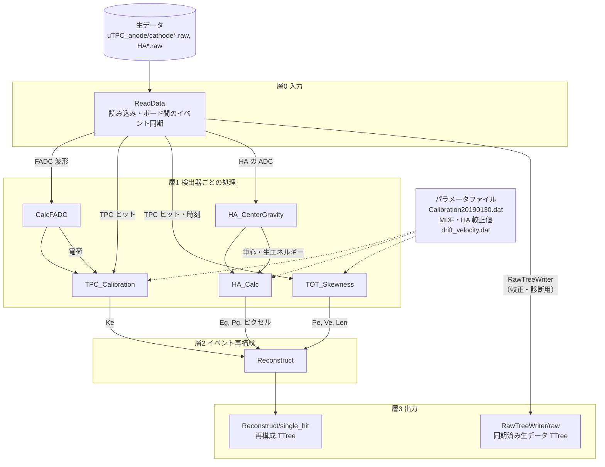

# EricaNext_try

**SMILE-2+ データで EricaNext の再構成チェーンを動かすための作業リポジトリ**

[EricaNext](https://github.com/SMILE-tool-box/EricaNext) は、SMILE プロジェクトの検出器生データ
（detector raw data）から、天体解析が可能なイベント再構成（event reconstruction）までを
一貫して処理するパイプラインソフトウェアです。ANLnext フレームワークをベースに構築されており、
解析モジュールを組み合わせてデータ処理フローを構成します。

`EricaNext_try` は、その中でもまず **SMILE-2+ の生データで再構成し**、ETCC解析についてのチュートリアル的な役割です。

## 使い方(まずここ)

実行するスクリプトは 2 つです。どちらも **最初の引数に設定ファイル** を渡します。
設定ファイルに、つなぐモジュールとそのパラメータ、データの場所をすべて書いておき、スクリプトはそれを読んでチェーンを組んで実行します。

| スクリプト | すること | 設定ファイル |
| --- | --- | --- |
| [`run_script/run_chain.py`](run_script/run_chain.py) | 生データ(実データ・シミュレーションの raw)の **再構成** | [`config/<名前>.json`](config/) |
| [`run_script/run_sim.py`](run_script/run_sim.py) | Geant4 の **シミュレーション**(検出器の応答をつけると実データと同じ形式の raw も書く) | [`config/simulation/<名前>.json`](config/README.md) |

```bash
cd run_script

# 再構成: 設定ファイル smile2p_20190701_Per02(= config/smile2p_20190701_Per02.json)
python3 run_chain.py smile2p_20190701_Per02 -o per02_out.root               # 全イベント
python3 run_chain.py smile2p_20190701_Per02 -o test.root -n 10000           # 先頭 1 万イベント
python3 run_chain.py smile2p_20190701_Per02 -o raw.root --raw --compression 505   # 同期した生データのツリー

# シミュレーション(先に source ~/opt/setup_sim.sh)
python3 run_sim.py smile2p_flight_parma_thermal_neutron_d10 -n 1000000 -o edep.root --seed 1
python3 run_sim.py smile2p_flight_parma_thermal_neutron_d10_raw -n 1000000 -o edep.root --seed 1 --raw-dir rawdata

# シミュレーションの raw を再構成する(上の rawdata を読む。新しいシェルで。setup_sim.sh は不要)
python3 run_chain.py smile2p_sim_d10_recon -o sim_recon.root --set ReadData.data_dir=rawdata
```

- 設定ファイルは名前(拡張子なし)で書くと `config/`(`run_sim.py` は `config/simulation/`)から探します。`.json` のパスを直接書いても構いません。
  省くとエラーになり、使える名前の一覧が出ます。
- 値を変えるときは、設定ファイルをコピーして書き換えるか、`--set` でその場だけ上書きします
  (`run_chain.py` は `--set モジュール.パラメータ=値`、`run_sim.py` は `--set 節.キー=値`)。
- 設定ファイルの各モジュールには、全パラメータの説明(`_doc`)と単位(`_units`)を書いています。
- 失敗すると終了コード 1 で終わります(データを最後まで読んだときと `-n` で止めたときは 0)。

| `run_chain.py` の引数 | 意味 |
| --- | --- |
| `<設定>` | 設定ファイル(必須) |
| `-o` | 出力の ROOT ファイル(必須) |
| `-n` | 処理するイベント数。省略すると全イベント |
| `--raw` | 再構成せず、`ReadData → RawTreeWriter` で同期した生データのツリーだけを書く |
| `--compression` | ROOT の圧縮設定(`505` = zstd レベル 5) |
| `--set モジュール.パラメータ=値` | パラメータの上書き(何回でも)。小数は `10.0` のように書く |

| `run_sim.py` の引数 | 意味 |
| --- | --- |
| `<設定>` | 設定ファイル(必須) |
| `-n` | 一次粒子の数(必須) |
| `-o` | エネルギー損失のツリー(`edep`)を書く ROOT ファイル。省略すると設定ファイルの値 |
| `--seed` | 乱数の種。省略すると設定ファイルの値 |
| `--raw-dir` | raw ファイルの出力先(`response` の節がある設定だけ) |
| `--set 節.キー=値` | パラメータの上書き(何回でも)。例: `physics.em_msc=urban`、`response.TPCEmulator.Vth_Anode=6000` |

詳しい説明(出力の中身、例、中でしていること)は [`run_script/README.md`](run_script/README.md)、
設定ファイルの書き方は下の「[設定ファイルで実行する](#設定ファイルで実行する)」と [`config/README.md`](config/README.md) にあります。

## 解析チェーン



- 矢印はデータの受け渡しです(ラベルは渡すもの)。点線はパラメータファイルの読み込みです。
- 実際の実行順は `ReadData → CalcFADC → TPC_Calibration → HA_CenterGravity → HA_Calc → TOT_Skewness → Reconstruct`
  (SMILE_tool_box の `setting.mac` と同じ)。`RawTreeWriter` は使うときだけ `ReadData` の直後につなぎます。
- 出力ファイルには TTree だけを書きます(図は保存しません)。処理の中身を確かめる図は、
  `RawTreeWriter/raw` と `Reconstruct/single_hit` から後で描きます(`tutorials_caldata/1_DataIO/modules/`)。
- どのモジュールも、失敗してもチェーンを止めずにセンチネル値(`0xffffffff`)を入れて続行します。
  解析では `single_hit` の `err_flag == 0` の行だけを使ってください。
- 実行時間の大半は生データの読み込みです。データはネットワーク越しではなく手元のディスクに置くと約 10 倍速くなります。

| モジュール | SMILE_tool_box での名前 | 主な出力 |
| --- | --- | --- |
| `ReadData` | `RawRead2p` | 同期したイベントの TPC ヒット・FADC 波形・HA の ADC |
| `CalcFADC` | `CalcFADC` | FADC 24 ch の電荷 |
| `TPC_Calibration` | `TPC_Calibration` | 反跳電子のエネルギー `Ke` |
| `HA_CenterGravity` | `HA_Center_Gravity` | PMT ごとの重心と生エネルギー |
| `HA_Calc` | `HA_Calc_s2` | 散乱ガンマ線のエネルギー `Eg`、吸収点 `Pg`、ピクセル |
| `TOT_Skewness` | `TOT_Skewness_Analysis` | 散乱点 `Pe`、電子の方向 `Ve`、飛程 `Len` |
| `Reconstruct` | `Reconstruct` | 再構成ツリー `Reconstruct/single_hit` |
| `RawTreeWriter` | (なし) | 生データツリー `RawTreeWriter/raw` |

## 検証状況

各モジュールは SMILE_tool_box_v2.20 と同じ処理になるよう移植し、20190701_Per02 のデータで
参照出力（`haboc_tmp_0.root` の `Reconstruct/s2t`）とビット単位で一致することを確認しています。
経緯は [`docs/per02_comparison_log.md`](docs/per02_comparison_log.md) を参照してください。

## チュートリアル

[`tutorials_caldata/`](tutorials_caldata/README.md) に、cosipy と同じ形式のチュートリアルがあります。
番号の順に読みます。データの入手方法は 1_DataIO にまとめてあります。

| フォルダ | 内容 |
| --- | --- |
| [`tutorials_caldata/0_Introduction/`](tutorials_caldata/0_Introduction/Introduction.ipynb) | SMILE-2+ の構成と座標系の定義(最初に読む) |
| [`tutorials_caldata/1_DataIO/`](tutorials_caldata/1_DataIO/DataIO_example.ipynb) | データのダウンロードと Erica によるデータ再構成。`modules/` 以下に各モジュールの解説(チェーンの順に番号付き) |
| [`tutorials_caldata/2_EventSelection/`](tutorials_caldata/2_EventSelection/EventSelection.ipynb) | イベント選択と、カットごとのエネルギースペクトルの変化 |
| [`tutorials_caldata/3_Backprojection/`](tutorials_caldata/3_Backprojection/Backprojection.ipynb) | 較正データのバックプロジェクション像 |

シミュレーションのチュートリアルは [`tutorials_simulation/`](tutorials_simulation/README.md) にあります。

| フォルダ | 内容 |
| --- | --- |
| `tutorials_simulation/0_Introduction/` | シミュレーションの全体の流れ、形状、環境(移植中) |
| `tutorials_simulation/1_PointSourceSim/` | 点線源のシミュレーション(準備中) |
| `tutorials_simulation/2_ParallelBeamSim/` | 平行光シミュレーション(準備中) |
| `tutorials_simulation/3_CosmicBGSim/` | 宇宙線バックグラウンドシミュレーション(準備中) |
| [`tutorials_simulation/4_PARMAFlux/`](tutorials_simulation/4_PARMAFlux/README.md) | PARMA で宇宙線のフラックスを作る(準備中) |

> **注意（Jupyter 実行時）**: `CalcFADC` は波形積分を `std::thread` で行うため、Jupyter の
> ipykernel プロセス内でチェーンをそのまま実行すると、カーネルごと落ちることがあります
> （プレーンな python スクリプトとしての実行では問題ありません）。そのためチュートリアルでは
> チェーンを別プロセスのスクリプトとして書き出し、`subprocess` で実行しています（`run_script/run_chain.py` を `subprocess` で呼ぶ）。

---

## 依存関係

- [ANLnext](https://github.com/odakahirokazu/ANLNext)
- [ROOT](https://root.cern/)
- [Boost](https://www.boost.org/) 1.80.0 以降
- CMake 3.8 以降
- C++ コンパイラ（C++17 対応）
- [SWIG](https://www.swig.org/)（Python 拡張の生成に必須）
- Python 3

### 環境変数

ビルド前に、以下の環境変数を設定しておきます（各自の環境に合わせる）。

| 環境変数 | 説明 |
| --- | --- |
| `ANLNEXT_INSTALL` | ANLnext のインストール先。未設定の場合は `$HOME` が使われる。 |

---

## インストール

### 1. ANLnext のインストール

先に ANLnext をインストールしておきます。
（インストール手順は ANLnext のドキュメントを参照してください。）

### 2. EricaNext のビルド

リポジトリのルートディレクトリで、以下を実行します。

```bash
mkdir build install
cd build
cmake ../source/ \
  -DCMAKE_INSTALL_PREFIX=../install \
  -DUSE_PYTHON=ON
make -j8
make install
```

> **メモ:** `USE_PYTHON` は `source/CMakeLists.txt` 内で既に `ON` に設定されているため、
> `-DUSE_PYTHON=ON` の指定は実際には省略可能です（明示のために残しています）。

---

## 環境依存の設定（各自の環境に合わせて変更してください）

上記コマンドのうち、以下のオプションは **実行環境ごとに変わります**。
自分の環境に合わせて書き換えてください。

| オプション | 説明 | 
| --- | --- | 
| `-DCMAKE_INSTALL_PREFIX=../install` | インストール先のディレクトリ。任意の場所に変更可。未指定時は `$HOME` にインストールされる。 | 
| `-DUSE_PYTHON=ON` | Python 拡張のビルド。ソース側で既定 `ON`。 | 
| `make -j8` | ビルドの並列数。`8` は使用するコア数に合わせて変更。 | 

### Python インタプリタを明示指定したい場合

`CreateSwigPython.cmake` は `find_package(Python3 REQUIRED COMPONENTS Interpreter Development)`
を使うため、複数の Python（conda / pyenv / system など）が混在する環境で使用する
Python を固定したい場合は、`Python3_EXECUTABLE` にパスを渡します(ANLnext install時も)。

```bash
cmake ../source/ \
  -DCMAKE_INSTALL_PREFIX=../install \
  -DPython3_EXECUTABLE=$(which python3)
```

---

## 使い方

チュートリアルは [`tutorials_caldata/`](tutorials_caldata/README.md) を参照してください。

### 設定ファイルで実行する

モジュールの順番とパラメータ、データ・較正ファイルの場所は、測定期間ごとの設定ファイル
[`config/*.json`](config/) にまとめています(SMILE_tool_box の参照実行と同じ値)。値を変えるときは設定ファイルだけを直します。
実行のしかたは上の「[使い方(まずここ)](#使い方まずここ)」、設定ファイルの書き方は [`config/README.md`](config/README.md) にあります。

#### 自分の環境に合わせて変える場所

設定ファイルのパスは `{data_top}/...` と書いてあり、`{data_top}` は実行時に次の順で探したディレクトリに置き換わります。

1. 環境変数 `SMILE2P_DATA`
2. `~/smile2p_data`(このディレクトリがあれば)
3. 研究室サーバー上の置き場所(`config/ericanext_config.py` の `SERVER_DIR`)

**データを次の形で置けば、設定ファイルは書き換えずにそのまま使えます。**

```
<データの置き場>/              ← ~/smile2p_data にする、または export SMILE2P_DATA=<データの置き場>
├── Per02_ETCC/                ← 生データ(uTPC_*.raw, HA*.raw)と drift_velocity.dat
├── Per03_ETCC/
└── param/20190528/            ← 較正ファイル(Calibration20190130.dat, XMDF/YMDF, Cal_HA, HAs.pos など)
```

```bash
export SMILE2P_DATA=/path/to/smile2p_data    # ~/smile2p_data に置いた場合は不要
```

置き方がこれと違う場合だけ、設定ファイル(例: `config/smile2p_20190701_Per02.json`)の次の値を自分のパスに書き換えます。
`{data_top}` を使わずに絶対パスを書いても構いません。

| モジュール | キー | 中身 | 既定値 |
| --- | --- | --- | --- |
| `ReadData` | `data_dir` | 生データのディレクトリ | `{data_top}/Per02_ETCC` |
| `TPC_Calibration` | `ParameterFile` | TPC の較正ファイル | `{data_top}/param/20190528/Calibration20190130.dat` |
| `HA_Calc` | `parameter_dir` | HA の MDF・較正値・`HAs.pos` のディレクトリ | `{data_top}/param/20190528` |
| `HA_Calc` | `Modified_Parameter_Data_Dir` | PMT ゲイン補正(`Mean_Sigma_HA*`)のディレクトリ | `{data_top}/param/20190528` |
| `TOT_Skewness` | `drift_velocity_file` | ドリフト速度の表 | `{data_top}/Per02_ETCC/drift_velocity.dat` |

- `reference` の 2 つのパス(`setting_mac`, `root`)は、SMILE_tool_box の出力との比較に使うだけで、チェーンの実行には使いません。
- 研究室サーバー以外(別の研究室など)で使う場合は、`config/ericanext_config.py` の `SERVER`(サーバー名)と
  `SERVER_DIR`(サーバー上の置き場所)も書き換えると、チュートリアルに表示される rsync のコマンドが正しくなります。
- どのパスが使われるかは、次で確認できます。
  ```bash
  python3 -c "import sys; sys.path.insert(0, 'config'); import ericanext_config as ec, json; \
              print(ec.data_top()); print(json.dumps(ec.load('smile2p_20190701_Per02')['parameters'], indent=1))"
  ```

### Python から直接使う

ビルドした Python モジュールは `<CMAKE_INSTALL_PREFIX>/lib/python` にインストールされます。
Python から import するには、このディレクトリを `PYTHONPATH` に追加してください。

```bash
export PYTHONPATH=<CMAKE_INSTALL_PREFIX>/lib/python:$PYTHONPATH
```

> **注意**: `/usr/local/lib/python` など、他の場所に別ビルドの `EricaPy` が入っていることが
> あります。`PYTHONPATH` は必ず `EricaNext_try/install/lib/python` を先頭（優先）に
> なるよう追加してください。順序を間違えると意図しない方のビルドが import され、
> パラメータやモジュールの挙動が変わって気づきにくいバグになります。

```python
import anlnext
import EricaPy as erica

a = anlnext.AnalysisChain()
a.chain(erica.SaveFile)
a.with_parameters({"filename": "output.root"})
a.chain(erica.ReadData)
a.with_parameters({"data_dir": "/path/to/raw/data", "reverse_TPC": False, "TPC_Only": False})
# ... CalcFADC, TPC_Calibration, TOT_Skewness, HA_CenterGravity, HA_Calc, Reconstruct と続く
a.run(-1)
```
